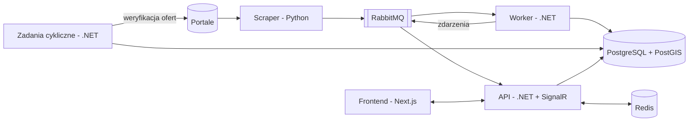

# Architektura

Dokumentacja architektoniczna projektu.

## 1. Założenia

* Docelowo ok. 100 aktywnych użytkowników.
* Jeden backend .NET (bez mikroserwisów) i jedna baza PostgreSQL.
* Preferowane darmowe narzędzia, hosting na Azure.

## 2. Komponenty



| Komponent | Odpowiedzialność |
|---|---|
| Scraper | Pobiera i waliduje oferty, publikuje je do RabbitMQ. Po przebiegu wysyła `scrape_finished`. |
| Worker | Zapis ofert, historia cen, geokodowanie, wykrywanie okazji, dopasowanie alertów. |
| Zadania cykliczne | Weryfikacja wygasłych ofert, statystyki cen, powiadomienia zbiorcze, wygasanie subskrypcji. |
| API | REST API, uwierzytelnianie, hub SignalR. |
| PostgreSQL + PostGIS | Jedyne źródło danych, wyszukiwanie po mapie. |
| Redis | Cache, backplane SignalR, rate limiting, blokady rozproszone. |

## 3. Przepływy

### 3.1 Nowa lub zaktualizowana oferta
1. Worker robi upsert po `(sourcePortal, sourceId)` i aktualizuje `lastSeenAt`.
2. Nowa oferta → zlecenie geokodowania. Zmiana ceny → wpis w `propertyPriceHistory`.
3. Porównanie ceny za m² z `priceStatistics` → ustawienie `isDeal`.
4. Dopasowanie alertów jednym zapytaniem SQL → rekordy `searchAlertNotifications` ze statusem `pending`.
5. Zdarzenie `AlertMatched` / `DealDetected` → API → SignalR do użytkownika.

### 3.2 Geokodowanie
1. Asynchronicznie, przez osobną kolejkę z limitem 1 żądanie/s.
2. Cache: Redis → tabela `geocodingCache` → Nominatim (za interfejsem `IGeocoder`).
3. Gdy pełny adres nie zostanie znaleziony: ulica + miasto → dzielnica + miasto → miasto.

### 3.3 Weryfikacja wygasłych ofert
1. Po pełnym, udanym scrapie wybierane są oferty z `lastSeenAt` < start przebiegu i `archivedAt IS NULL`.
2. Żądanie HTTP pod `sourceUrl`. Reguły wygaśnięcia osobne dla każdego portalu (`IOfferExpirationChecker`).
3. Wynik `Active` → aktualizacja `lastSeenAt`. `Expired` → ustawienie `archivedAt`. `Unknown` → ponowienie, bez archiwizacji.
4. Limit żądań na portal i ponowienia przez `Microsoft.Extensions.Http.Resilience`.

### 3.4 Powiadomienia
* SignalR (w aplikacji): natychmiast.
* E-mail i SMS: natychmiast albo zbiorczo co godzinę / raz dziennie, z uwzględnieniem cichych godzin. Domyślnie zbiorczo.

### 3.5 Statystyki cen
Zadanie cykliczne przelicza `priceStatistics` (średnia i mediana ceny za m²) surowym SQL. To model odczytu.

## 4. Backend (.NET 10)

```
src/
  Domain/           encje i reguły (oferta, subskrypcja, alert)
  Application/      komendy, zapytania, handlery, interfejsy; foldery wg funkcji
  Infrastructure/   Persistence, Messaging, Caching, Geocoding, Notifications, Payments, Identity
  Api/              Minimal API, uwierzytelnianie, SignalR
  Worker/           Consumers/ (kolejki), Jobs/ (zadania cykliczne)
  AppHost/          .NET Aspire
  ServiceDefaults/  OpenTelemetry, health checks
tests/
  UnitTests/        Domain/, Application/
  IntegrationTests/ API + Worker na Testcontainers
```

* Lekka Clean Architecture: API i Worker współdzielą logikę, usługi zewnętrzne są za interfejsami.
* Endpointy i consumery są cienkie: przyjmują dane i wołają handler.
* Bez generycznego repozytorium: handlery używają `IAppDbContext`.
* Użytkownik z Identity żyje w Infrastructure, domena zna tylko `UserId`.
* Lekki CQRS: komendy przechodzą przez domenę i zwracają `id`, zapytania zwracają DTO
  (`AsNoTracking`, surowy SQL). Jedna baza.
* Bez MediatR: własne `ICommandHandler` / `IQueryHandler`. Dekoratory (Scrutor) tylko
  dla walidacji i logowania. Cache (`HybridCache`) jawnie w wybranych zapytaniach.
* Uwierzytelnianie: Identity (klucz `Guid`) + Google, JWT + refresh token w ciasteczku `httpOnly`.
* API: `ProblemDetails`, rate limiting, OpenAPI + Scalar.

## 5. Technologie

| Obszar | Wybór |
|---|---|
| Baza i dostęp do danych | EF Core, Npgsql, NetTopologySuite |
| Kolejka | MassTransit v8 (raw JSON) |
| Cache | Redis + `HybridCache` |
| Czas rzeczywisty | SignalR + backplane Redis |
| Logi i monitoring | Serilog, OpenTelemetry, Application Insights |
| Testy | xUnit, Testcontainers, `WebApplicationFactory`, Shouldly |
| Płatności | Stripe |
| E-mail / SMS | Brevo / Resend, Mailpit (dev) / SMSAPI |
| Geokodowanie | Nominatim |

Świadomie nieużywane: MediatR, AutoMapper, FluentAssertions v8, Elasticsearch, mikroserwisy, Kubernetes.

## 6. Frontend (Next.js)

| Obszar | Wybór | Uzasadnienie |
|---|---|---|
| Framework | Next.js (App Router) + React + TypeScript | SSR/SSG dla stron ofert (SEO), Server Components |
| UI | Tailwind CSS + shadcn/ui | Gotowe, dostępne komponenty, kod w projekcie, nie w bibliotece |
| Komunikacja z API | Klient generowany z OpenAPI backendu (openapi-typescript + openapi-fetch) | Typy zawsze zgodne z API, bez ręcznego pisania |
| Dane po stronie klienta | TanStack Query | Cache, odświeżanie, stany ładowania (filtry, ulubione, alerty) |
| Filtry wyszukiwania | Parametry w adresie URL (nuqs) | Link do wyników można udostępnić, działa przycisk „wstecz” |
| Formularze | React Hook Form + Zod | Walidacja formularzy (alerty, rejestracja) |
| Mapa | MapLibre GL JS + OpenFreeMap | Darmowe mapy bez klucza API; rysowanie obszaru: Terra Draw |
| Wykresy | Recharts | Historia cen, statystyki |
| Czas rzeczywisty | @microsoft/signalr | Klient do huba SignalR |
| Uwierzytelnianie | Własna obsługa JWT z backendu (refresh token w ciasteczku `httpOnly`) | Backend wydaje tokeny, NextAuth/Auth.js zbędny |
| Testy | Vitest + Testing Library, Playwright (E2E) | |
| Jakość kodu | ESLint + Prettier, pnpm | |

Świadomie nieużywane: Redux (stan serwera trzyma TanStack Query, filtry są w URL),
Google Maps / Mapbox (płatne powyżej limitów).

## 7. Baza danych

Diagram: https://dbdiagram.io/d/69c3d600fb2db18e3b0015c8

Planowane zmiany:
* Nowe tabele: `refreshTokens`.
* `notificationPhoneConfirmed`.

## 8. Hosting (Azure)

| Element | Usługa |
|---|---|
| API | Container Apps (min. 1 replika) |
| Worker | Container Apps + KEDA (skalowanie od długości kolejki) |
| Scraper, zadania cykliczne | Container Apps Jobs (cron) |
| Baza | PostgreSQL Flexible Server B1ms (12 mies. za darmo) |
| RabbitMQ | CloudAMQP (plan darmowy) |
| Redis | Kontener / Upstash |
| Frontend | Container Apps / Static Web Apps |
| Obrazy, CI/CD | GHCR, GitHub Actions |
| Monitoring | Application Insights |

Budget Alert w Azure od pierwszego dnia.

## 9. Otwarte kwestie
* `scrape_finished` musi zawierać identyfikator i czas startu przebiegu.
