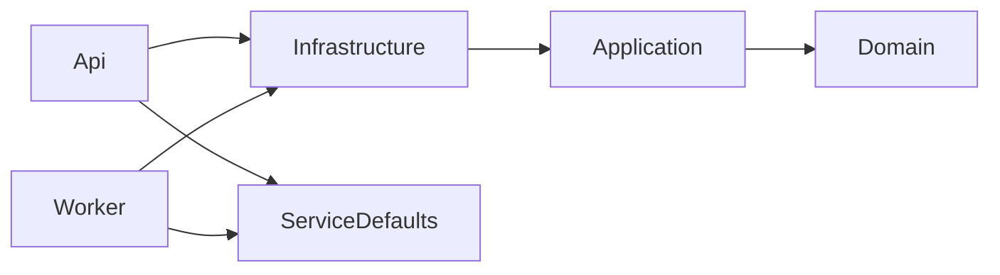

# Backend

Opis podejść stosowanych w backendzie (.NET), struktury rozwiązania i powodów, dla których tak jest.
Uzupełnia [ARCHITECTURE.md](ARCHITECTURE.md): tam jest obraz całego systemu, tu zasady pracy z kodem backendu.

To żywy dokument. Opisuje stan kodu i decyzje podjęte do tej pory, a nie reguły nie do ruszenia.
Jeśli znajdziemy lepsze rozwiązanie, zmieniamy kod i ten plik.

## 1. Podejścia w skrócie

| Obszar | Podejście | Dlaczego |
|---|---|---|
| Architektura | Lekka Clean Architecture: Domain ← Application ← Infrastructure ← Api / Worker | API i Worker współdzielą logikę, a domena jest chroniona przed szczegółami technicznymi |
| Organizacja kodu | W Application foldery wg funkcji (np. `Offers/UpsertOffer`), w Infrastructure wg technologii | Łatwo znaleźć wszystko, co dotyczy jednej funkcji, bez przeskakiwania między katalogami typu `Commands`, `Handlers` |
| Zapis i odczyt | Lekkie CQRS: komendy przechodzą przez domenę, zapytania zwracają DTO | Zapis pilnuje reguł, odczyt jest szybki i nie ładuje encji |
| Handlery | Własny `ICommandHandler<T>`, bez MediatR | Mało kodu, brak zewnętrznej zależności, wystarczy do tej skali |
| Dostęp do danych | EF Core przez `IAppDbContext`, bez generycznego repozytorium | Repozytorium nad EF Core dodaje warstwę bez zysku przy jednej bazie |
| Model domeny | Bogate encje: stan zmienia się tylko przez metody, settery są prywatne | Niezmienniki (np. cena za m², historia cen) są w jednym miejscu |
| HTTP | Minimal API, endpointy cienkie, bez kontrolerów | Mniej ceremonii; endpoint tylko mapuje dane i wywołuje handler |
| Konfiguracja | Zmienne środowiskowe (`EnvironmentService`), lokalnie `launchSettings.json` | Działa na każdym hostingu, sekrety nie trafiają do repozytorium |
| Kolejka | RabbitMQ (`RabbitMQ.Client`), ręczne potwierdzanie wiadomości | Scraper już deklaruje topologię; prosty konsument wystarcza |
| Geokodowanie | Nominatim za interfejsem `IGeocoder`, cache w PostgreSQL | Polityka Nominatim wymaga cache'u i limitu 1 żądanie/s; Redisa jeszcze nie ma |

## 2. Struktura rozwiązania

```
src/
  PropertyAggregator.Domain/            encje, obiekty wartości, enumy, reguły
  PropertyAggregator.Application/       przypadki użycia, interfejsy (porty), kontrakty wiadomości
  PropertyAggregator.Infrastructure/    baza, HTTP, cache, konfiguracja techniczna
  PropertyAggregator.Api/               Minimal API, OpenAPI/Scalar, /health
  PropertyAggregator.Worker/            konsumenci kolejki i zadania w tle
  PropertyAggregator.ServiceDefaults/   OpenTelemetry, health checki, resilience dla HTTP
tests/
  PropertyAggregator.UnitTests/
  PropertyAggregator.IntegrationTests/
docker-compose.yml                      lokalny PostgreSQL z PostGIS
```

### Zależności między projektami



Zasada: zależności idą tylko do środka. Domain nie zna nikogo, Application nie zna Infrastructure.
Hosty (`Api`, `Worker`) składają całość w `Program.cs`.

### Co gdzie leży

| Projekt | Zawartość |
|---|---|
| Domain | `Models/Properties` (`Property`, `PropertyDetails`, `PropertyPriceHistory`, `GeoPoint`), `Models/Statistics`, `Enums` |
| Application | `Abstractions` (`IAppDbContext`, `ICommandHandler<>`, `IGeocoder`), `Offers/Contracts`, `Offers/UpsertOffer`, `Geocoding/GeocodePendingProperties` |
| Infrastructure | `Persistence` (`AppDbContext`, `Configurations`, `Converters`, `Migrations`), `Geocoding` (klient Nominatim, cache, ograniczenie żądań), `Services/EnvironmentService` |
| Api | Endpointy w `Endpoints/` (planowane), `Program.cs` |
| Worker | `Consumers/` (kolejki), `Jobs/` (zadania cykliczne) |

## 3. Gdzie dodać nowy kod

| Zadanie | Miejsce |
|---|---|
| Nowa reguła biznesowa dotycząca jednej encji | Metoda w encji (Domain) |
| Nowy przypadek użycia | Folder funkcji w Application: komenda (lub zapytanie) i handler |
| Nowa zewnętrzna usługa (powiadomienia, płatności) | Interfejs w `Application/Abstractions`, implementacja w `Infrastructure/<Technologia>` |
| Nowy endpoint | Plik w `Api/Endpoints`: mapuje żądanie na komendę, wywołuje handler, zwraca kod HTTP |
| Nowy konsument kolejki lub zadanie w tle | `Worker/Consumers` lub `Worker/Jobs`; tylko deserializacja i wywołanie handlera |
| Zmiana schematu bazy | Konfiguracja w `Infrastructure/Persistence/Configurations` i nowa migracja |

## 4. Konwencje

- **Encje:** prywatne settery i konstruktor tworzący poprawny obiekt. Aktualizacja danych z zewnątrz idzie przez jedną metodę (`Property.ApplyObservation`), a nie przez przypisania pól.
- **Dane oferty:** pola, które mogą się zmieniać między przebiegami scrapera, są w rekordzie `PropertyDetails`. Tożsamość i klasyfikacja (portal, `sourceId`, typ nieruchomości i transakcji) ustawiane są raz.
- **Wartości pochodne** (np. cena za m²) liczy domena. Nie pobieramy ich ze źródła.
- **Czas:** zawsze UTC (`timestamptz`). Czas obserwacji pochodzi z `scrapedAt`, a `UpdatedAt` zmienia się tylko wtedy, gdy dane faktycznie się zmieniły.
- **Współrzędne:** w domenie `(latitude, longitude)`. Odwrócenie do kolejności PostGIS (długość, szerokość) jest tylko w `GeoPointConverter`.
- **Baza:** tabele i kolumny w camelCase (`UseCamelCaseNamingConvention`), enumy zapisywane jako tekst małymi literami z limitem długości.
- **Współbieżność:** optymistyczna, na kolumnie systemowej `xmin`. Kilka konsumentów może zapisywać tę samą ofertę, a konflikt kończy się ponowieniem.
- **Asynchroniczność:** każda metoda z I/O przyjmuje `CancellationToken` i przekazuje go dalej.
- **Wyjątki:** tylko dla sytuacji wyjątkowych. „Cena się nie zmieniła" nie jest wyjątkiem.
- **Sekrety i konfiguracja:** nie trafiają do kodu. Lokalne wartości dla kontenerów z `docker-compose.yml` są w `launchSettings.json`.

## 5. Zaimplementowane przepływy

### Odbiór oferty

1. Scraper publikuje ofertę (klucz `offer`) na exchange `property_scraper`.
2. `OfferConsumer` deserializuje wiadomość (`OfferMessage`) i woła `UpsertOfferHandler`.
3. Handler szuka oferty po `(portal, sourceId)`. Nową tworzy, istniejącą aktualizuje przez `ApplyObservation`.
4. Zmiana ceny dopisuje wpis do `propertyPriceHistory` i przelicza cenę za m².
5. Błędy: niepoprawny JSON odrzucamy bez ponowienia, inne błędy ponawiamy raz. Oferty są publikowane przy każdym przebiegu, więc utrata pojedynczej wiadomości sama się naprawia.
6. Wiadomości `scrape_event` są na razie potwierdzane i pomijane.

### Geokodowanie

1. `GeocodingJob` co 5 s bierze paczkę ofert z miastem i bez lokalizacji.
2. `GeocodingQueryBuilder` buduje zapytania od najdokładniejszego: ulica + dzielnica + miasto, ulica + miasto, dzielnica + miasto, samo miasto (z usunięciem `ul.`, `al.` itp.).
3. `CachedGeocoder` sprawdza tabelę `geocodingCache`. Gdy nie ma wpisu, pyta Nominatim i zapisuje wynik, także „nie znaleziono".
4. Pierwszy trafiony poziom zapisuje się w ofercie razem z precyzją (`street`, `district`, `city`). Gdy nic nie znaleziono, oferta dostaje `geocodedAt` i nie jest ponawiana do czasu zmiany adresu.
5. Żądania do Nominatim są ograniczone do jednego na 1,1 s (także ponowienia), a `User-Agent` identyfikuje aplikację.

## 6. Świadome decyzje

| Nie używamy | Dlaczego |
|---|---|
| MediatR | Własny `ICommandHandler` wystarcza, brak zależności i magii |
| AutoMapper | Mapowanie ręczne jest jawne i łatwe do prześledzenia |
| Generyczne repozytorium | `IAppDbContext` daje to samo bez dodatkowej warstwy |
| Kontrolery MVC | Minimal API jest lżejsze i pasuje do cienkich endpointów |
| Aspire AppHost | Baza i kolejka są już w `docker-compose`; AppHost nie dawał korzyści, a wymagał dodatkowych narzędzi. `ServiceDefaults` zostaje |
| Redis (na razie) | Przy jednej instancji API i Workera żadna funkcja go nie wymaga. Cache geokodowania jest trwały w bazie za interfejsem, więc Redisa można dodać później |
| MassTransit (na razie) | Scraper wysyła zwykły JSON i sam deklaruje topologię; bezpośrednie `RabbitMQ.Client` jest prostsze. Do ponownej oceny przy bardziej złożonym przesyłaniu wiadomości |
| Dziedziczenie `Property` per typ | Prawie wszystkie operacje działają ponad typami. Jedna tabela z kolumną `propertyType` jest gotowa na TPH, gdy domy i działki dostaną własne pola |

## 7. Do zrobienia

- Obsługa `scrape_event` i archiwizacja wygasłych ofert (zależy od otwartej kwestii z `ARCHITECTURE.md`: id i czas startu przebiegu).
- Zerowanie `ArchivedAt` przy ponownym zobaczeniu oferty.
- Wykrywanie okazji i dopasowanie alertów.
- Endpointy API (m.in. oferty na mapie w widocznym obszarze) wraz z globalną obsługą wyjątków (`IExceptionHandler`, `ProblemDetails`) i własnymi typami wyjątków.
- Przy skalowaniu poziomym Workera: blokada, aby tylko jedna instancja geokodowała (limit Nominatim jest lokalny dla procesu).
